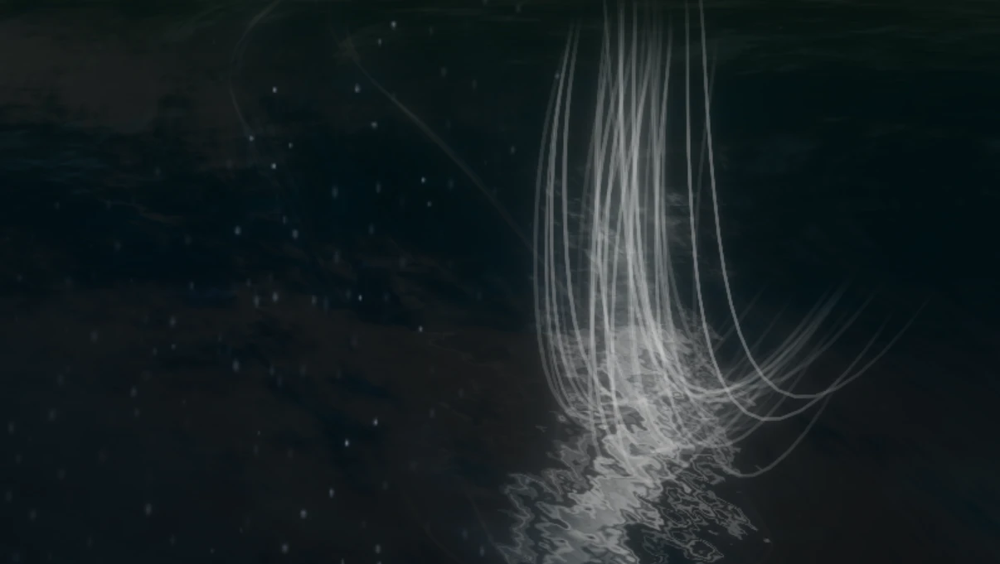
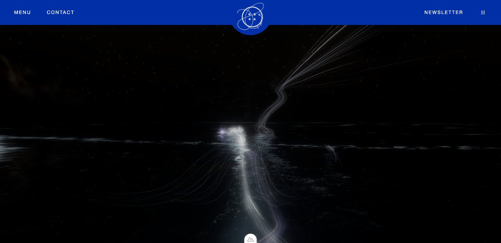

# The weaves (written 12 October 2026)

This file is for talking about the weaving: with the owner, and with whoever works on it next,
person or AI assistant. `HANDOFF.md` covers the whole site; this covers only what the thirteen
channellers put out over the sea, one weave at a time, in plain words, with the address to see
each one and where it lives in the code.

Two versions have names, so that the owner can come back to either or cancel the later one:

- **The Tending**: git tag `the-tending`, commit `52566d0`. The owner loved it. To return to it:
  check out that tag.
- **The Sky-Scan**: git tag `the-sky-scan`, one commit on top of The Tending, 12 October. It
  holds only that day's weave work: the sky-scanning weave sent up by two to five channellers,
  its flows following the real air, and the healing flow's colours muted by 46%. The owner
  likes it "for now" and asked for the name in order to be able to cancel it later. **To cancel
  it: `git revert the-sky-scan`**, which takes that one commit back out and leaves the wider
  view, and anything done since, as they are.

The wider and higher view (190° across, 62° up) is a separate commit straight after it and is
not part of The Sky-Scan.

Nearly everything below was judged from still pictures taken by a headless browser, never
watched in motion. Treat any claim about how something *moves* as unverified.

## The one the owner singled out

The owner sent this picture on 12 October and asked for this file "to talk about weaves, and
especially this one".

### What the owner said about it (12 October)

It is the **sky-scanning weave**, and it is liked: "a bunch of the weavers channelling into the
air and the way it spreads into separate flows BASED ON THE ACTUAL WIND DATA". And a rule: these
weaves "have to commence FROM the boat from at least two–5 channellers of varying strengths".

In the code it is still called the "scout". It was changed the same day to match those words:
that change is The Sky-Scan (see the top of this file).

### What it does, in order

1. **From the boat, several of them.** Two to five channellers each send their own tress from
   their own place at the rail. A stronger one's tress has more filaments in it. The eager begin
   at once, the slow a few seconds after.
2. **Out low, together.** The tresses run out about 90 m just above the sea and run together as
   they go. The real surface current carries and bends them.
3. **Up.** As one, it lifts off the water in a curve, steeply, to about 80 m.
4. **Finds the air.** As it climbs it leans downwind, the way the real wind is blowing now.
5. **Parts into five flows that follow the air.** One bound for each of five heights: the sea,
   and about 750 m, 1.5 km, 3 km and 5.5 km up. Each is carried as air let go there would be
   (the owner, 12 October: "literally allow it to follow airflow but remember the rules of
   thermodynamics"). Climbing, it passes through every layer below its own and is taken along
   by each layer's wind while it is in it, so where the wind turns with height the flow curves.
   Arrived, it runs level downwind. How far it goes is the wind's speed in true proportion
   ("widen the speed"): four times the wind, four times as far.
   How fast it can climb is each layer's doing. Lifted air cools by 9.8 °C a kilometre. Where
   the sky cools nearly that fast with height, the flow rises steeply; where it cools slowly,
   the flow rises slowly and is carried far sideways; where it grows warmer with height (an
   inversion, a lid), the flow is held down and spreads out beneath it.
6. **Drawn in, let out.** While a gust blows the flows are drawn in, the highest first; as it
   passes they are let out again. What is learnt travels down it: the light runs towards the boat.
7. **Let go.** It is cut at the boat, goes on up by itself, and fades high and soft.

### What in it comes from real data

| What you see | What it follows |
|---|---|
| How many send it up, two to five | how differently the five heights are blowing: two when the whole sky blows one way, five when every layer differs |
| Who they are | those not at the front, the air-minded and curious likeliest; their true strengths set how thick each tress is |
| Its bend on the water | the surface current across the view |
| How long it stays on the water, how high it gets | sea temperature against air temperature |
| Its lean in the air | the wind at the sea now |
| Where each of the five flows goes, how it curves, and how far | the wind now at every height it passes through, direction and speed |
| How steeply each flow climbs, and whether it is held down | how fast the air cools with height in each layer, from its real temperatures at the five heights |
| How much the flows waver | how gusty the wind is; in a steady wind they lie still |
| Whether it is there at all | by night: no moon, wind under about 22 km/h, no storm, the sea not calling for all four; at any hour: the strongest looking into something unusual in the air, for 10 to 16 seconds |

### What does not come from data

- The moment each gust arrives is made up (as everywhere on the site); its size is real.
- Which place at the rail each one takes is by chance.
- A small sway of the stem, and the travelling of the light down it, are on fixed rhythms.
- Heights are not to scale: 5.5 km of sky is drawn within about 200 m. Distances along the
  wind are in true proportion to one another, but not to the heights.
- Tomorrow's wind no longer shapes it at all. It still helps decide whether it is sent up.
- The 9.8 is for dry air. In cloud, lifted air cools by only about 6, and rises more easily
  than is drawn here. Cloud is not taken into account.

The forty-second breathing and the made-up wandering of the five companies are gone.

### Where it lives, and how to see it

- Code: `scoutVertexShader` and `tendScout` in `app/utils/channellers.ts`; the long comment
  above `SCOUT_FILAMENTS` is the owner's brief. The winds at height are fetched in
  `app/utils/manawatawhi.ts` (`windsAloft`).
- At night: `http://localhost:3000/?hour=23&date=2026-10-11` (a night without a moon).
- With `&controls`: the "sky" row gives the wind at each of the five heights, "sky cools by"
  gives each layer's cooling in °C a kilometre, and "at the front" ends with "scanning the
  sky:" and the names of those sending it up.
- To try a lid: `&pretend=airLowTemperature:12,airCloudTemperature:19`.
- To try a sky whose layers differ, pretend them, for example
  `&pretend=windLowDirection:200,windCloudDirection:120,windMidDirection:40,windHighDirection:300,windHighSpeed:90`.
- The strongest's version: add `&pretend=windTrend:20` to any address and wait a few seconds.
  The strongest is then the first of those sending it, from their own seat, and only the
  strongest's tress in it is white.

### Still open

- Near the boat the separate tresses are fine and close; it is hard to count the senders by eye.
- When the whole sky blows one way (as on 12 October) the five flows lie nearly on one another.
  That is true to the wind, but there is less to see.
- Being drawn in during a gust is the assistant's idea, to replace the clock. Unreviewed.
- It is fine and sharp where the night readings are broad and soft. Which is right for the night?
- It is still drawn pale blue-white, not in air's colour.

## All the weaves

Thirteen channellers are on the boat. Four sit at the front at a time; the others rest, take
turns, sound the water, or weave deep round the boat. The strongest (the owner) is always one of
the four.

| Weave | Who | When | What it looks like | What drives it | To see it |
|---|---|---|---|---|---|
| **Pressure reading** | one at the front, the air-minded most | when the barometer is moving, or nobody has looked for some minutes | a stem up into the air that opens level at its top and holds, like a held breath | `pressureTrend`: steady, a flat disc; falling, lower, drooping rim, greyer; rising, higher, lifted rim, golden | `/?hour=16.5&show=pressure&pretend=pressureTrend:-0.9` |
| **Wind reading** | one at the front, the air-minded most | when the wind is strong, gusty, or a gust comes | a stem up at a slant whose filaments stream off downwind | wind speed, direction, gust factor: long and flat in a fresh wind, short and drooping in a light air; it is sent towards where the wind comes from | `/?hour=16.5&show=wind&pretend=windSpeed:30,windGusts:42` |
| **Water reading** | one at the front, the water-minded most | when a set of higher waves passes, the sea and air differ in warmth, or the current runs | out low on one side, under the surface, back on the other, loosened | waves under the boat; sea against air temperature gives its returning colour (rose-gold warmer, violet colder, aquamarine alike); the current carries it; it is sent towards where the swell comes from | `/?hour=16.5&show=water&pretend=seaTemperature:22` |
| **Healing flow** | all at the front, linked | when a set of waves has passed and the water eases, or after 90 seconds without that | one braided flow, low over the water, that sinks into the sea about 100 m out; the water there turns bluer and glows faintly for some minutes | the waves under the boat set when; how much the sea is doing sets how hard it is driven. Its colours are muted by 46% (the owner's figure, 12 October) | `/?hour=16.5&show=healing` |
| **Sky-scanning weave** ("scout") | two to five of those not at the front, or the strongest with others | see above | see above | see above | `/?hour=23&date=2026-10-11` |
| **Soundings** | three or four of those *not* at the front | every two or three minutes | fine plaited tresses that run shallow under the waves and come back | sea against air temperature, the current; who takes part is by temperament | `/?show=soundings` |
| **Dawn and dusk link** | all thirteen | sun between 9° under and 8° over the horizon | one great flow towards Hawaiʻi that climbs a little and dives into the horizon | the hour; how much the sea calls for | `/?hour=19.2` |
| **Storm link** | the four, linked | in a storm, any hour | the flow thrown wide over the waves, entering each one | wave height, wind | `/?pretend=waveHeight:6,windSpeed:70,windGusts:95` |
| **Deep weaves** | the weaker ones, at times the strongest | when the sea would carry the boat too fast | plaits in rings just under the surface round the boat | current and wind against the pilgrimage's pace | `/?show=masters` |

`/?controls` adds two rows, "at the front" and "calling", that name who is at what and how
loudly the wind, the pressure and the water are each calling. Leave `controls` out of the
address to see the picture without the panel.

## The rules now in force for every weave

Each of these came from the owner, in these words or close to them.

- **They are pilgrims, healing.** "They are not trying to electrocute the air or water!" Nothing
  jagged, flickering or striking. September's weave to a knot in the sky is put away.
- **Always tending**, moon or no moon. "Elegant. Odyssey-like."
- **Individuals.** "It should feel like there are individuals reading the weather."
- **Visible.** "White on white is ugly." By day every thread has a deeper sheath beside it.
- **Each act its own form, tied to what is really there.**
- **Turns are slow and meant.** "The intention and force needs to steadily move to the new focal
  point with the weavers applying more energy towards POV to redirect." A turn takes 12 seconds,
  runs out from the boat, and is a curve.
- **Responsive, not loopy.** "Too loopy and repetitive instead of responsive to actual wind,
  wave, air, air pressure etc data." Nothing at the front runs to a clock.
- **No corners.** "Weaves are rarely so angular."
- **Older rules that still stand:** they only feed what sea and wind are already doing; strong
  weaves do not equal brightness; nothing bright may hang in the sky; never paint patterns over
  the sea; weaves begin and end at the boat; a weave let go is never wiped away where it lies.

## Colour

- **Air** violet-blue `#9e7bf3`, **water** sea green `#00b0a2`, **akasha** bronze-gold `#e0b065`,
  **the strongest** white, edged `#0050cb`. A trial, agreed to by the owner on 12 October; an
  older note in the README says the elements should not be strongly coloured.
- By day the colour sits in the sheath and tints the thread. By night the light of each weave
  leans to the same colour, paled. On top of that a reading takes the colour of what it finds.
- **To change them:** add `colours` to any address. A strip of four swatches appears at the foot
  of the page; a change shows at once and is written into the address, so an address is a
  palette. Example: `/?hour=16.5&colours&show=healing`.
- What is picked is the dye, not the result: sea, sky and hour all change how it lands.
- Akasha has no act of its own. It appears only as one of the three strands in the healing flow.

## Words for talking about a weave

| Word | Meaning here |
|---|---|
| filament, thread | one hair-fine line |
| tress | the sixty-four filaments one channeller puts out |
| sheath | the band of deeper colour beside each thread by day |
| veil, halo | broad, faint glow about a tress at night |
| stem | the part of a reading that rises from the boat |
| reading | a weave sent out to feel the pressure, the wind or the water |
| linked | the four working as one |
| turn | changing from one thing to another without letting go |
| let go | cutting a weave at the boat; the cut end then runs out along it |
| calling | how loudly the wind, pressure or water is asking to be read, 0 to 100% |

The most useful things to send when something is wrong or right: the full address, the hour, and
a picture. A photograph or painting whose colour or line is right is worth more than a word.

## Known to be wrong

- All sky forms are soft and blurred, so the wind reading's torn ends cannot be seen.
- The middle of a water reading is simply out of sight; it is not seen going under.
- By night the readings are faint, and the healing flow is mostly white with little colour.
- Under a moon the tops of stems show as small points of light.
- Soundings stand out of the water as small hoops.
- You cannot tell one channeller from another by their weave; only the kind of reading shows.
- The twelve names and temperaments are the assistant's invention and unreviewed by the owner.
- The forecast changes about hourly, so within one visit only the waves under the boat and the
  gusts actually move. The moment each gust arrives is made up; its size is real.
- Dawn, dusk and storm have not been looked at since the readings, turns and colours were added.
- The healed water's fading over minutes has never been watched.

## For an AI assistant

- The owner is not a programmer: plain words, exact addresses, pictures of the result. British
  English. Never "she" or "he" of the strongest.
- Do not commit until the owner says "commit and push". Never delete: move to `.trash/`.
- GLSL lives inside JavaScript template strings: a backtick in a shader comment breaks the
  build, and a GLSL reserved word (`cast` was one) makes the shader fail without a build error.
  Read the browser console after every shader change.
- Another piece of work, the twilight sky, sits uncommitted in the same folder
  (`twilight-sky.ts`, parts of `OceanBackground.vue`, `manawatawhi.ts`, the README). The owner
  has twice said not to commit it yet. Keep it out of weaving commits.
